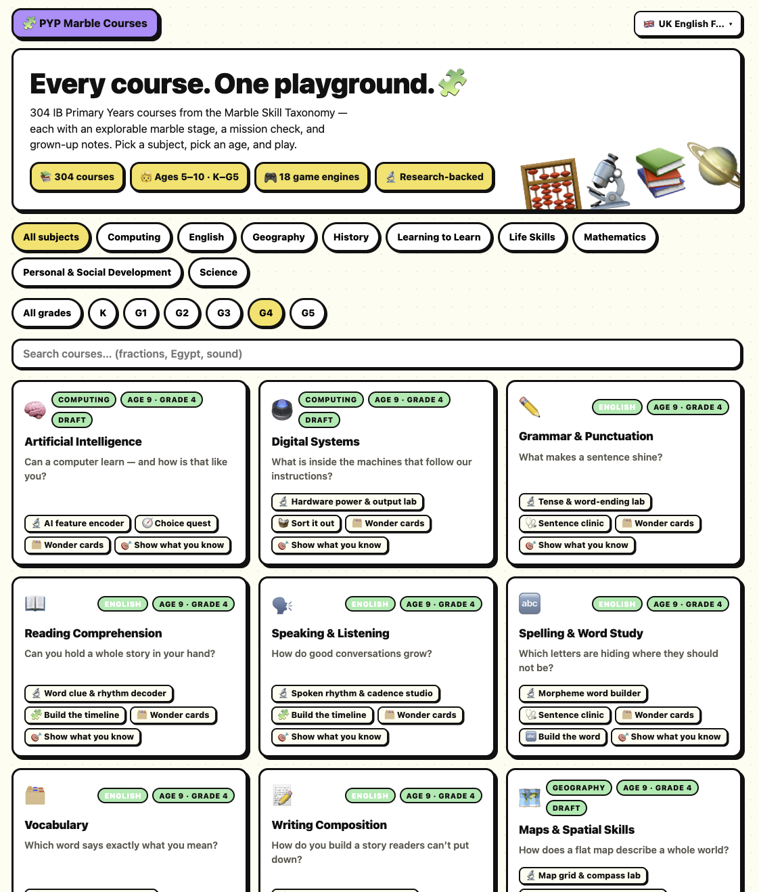
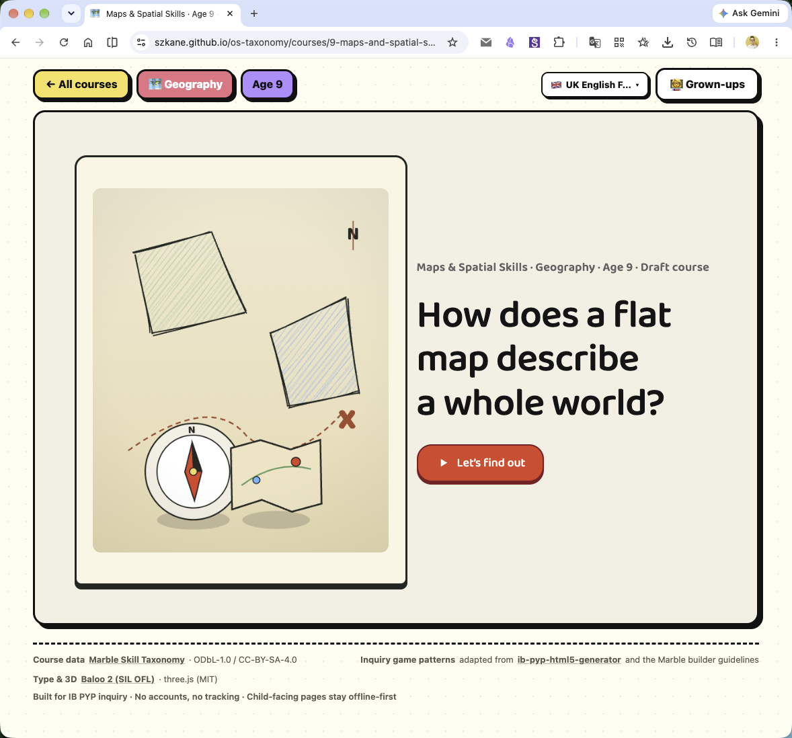
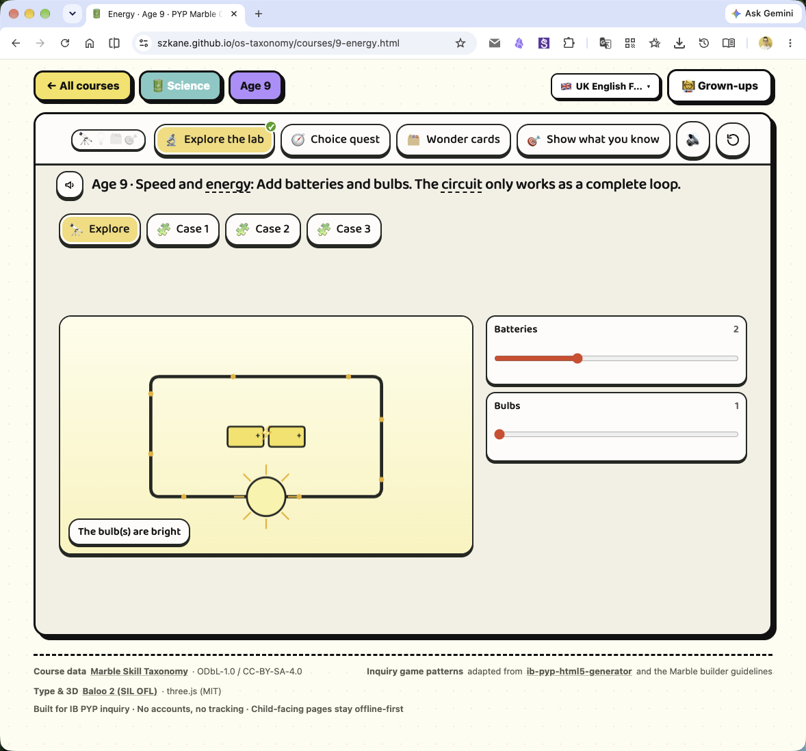
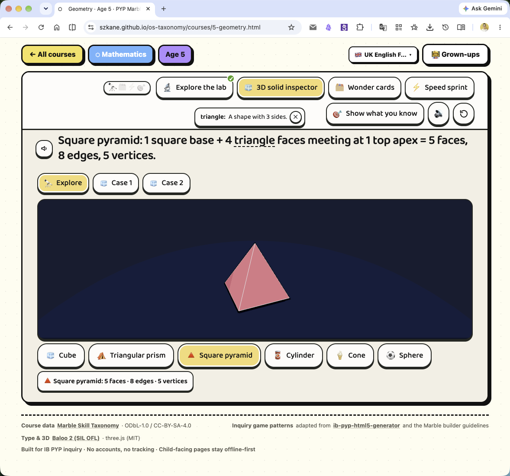

<div align="center">

# PYP Marble Courses

### An AI-Generated, Inquiry-First IB PYP Learning & Practice Platform for Primary Education (Ages 5–10 / K–G5)

[](https://szkane.github.io/os-taxonomy/)
[](https://szkane.github.io/os-taxonomy/)
[-FFE156?style=for-the-badge)](#curriculum-architecture)
[](#ib-pyp-pedagogical-framework)
[-B388FF?style=for-the-badge)](#interactive-simulation--game-engines)
[](#credits--licenses)

<p align="center">
  <a href="https://szkane.github.io/os-taxonomy/"><strong>Explore Live Playground »</strong></a>
  <br />
  <br />
  <a href="#demo-video">Demo Video</a>
  ·
  <a href="#screenshots">Screenshots</a>
  ·
  <a href="#key-features">Key Features</a>
  ·
  <a href="#interactive-simulation--game-engines">Engines</a>
  ·
  <a href="#ib-pyp-pedagogical-framework">Pedagogy</a>
  ·
  <a href="#curriculum-architecture">Curriculum</a>
  ·
  <a href="#getting-started">Getting Started</a>
  ·
  <a href="README.zh-CN.md">简体中文</a>
</p>

</div>

---

> [!NOTE]
> **Project Scope & Heritage:** This repository is an open demonstration platform for AI-orchestrated primary education. Built atop the open [**Marble Skill Taxonomy**](https://github.com/withmarbleapp/os-taxonomy) (1,838 learning topics, 3,878 prerequisite edges, 9 subjects), the [`/marble-builder`](.agents/skills/marble-builder/SKILL.md) design framework, and the [**ib-pyp-html5-generator**](https://github.com/szkane/ib-pyp-html5-generator) skill, this project generates **304 fully playable, offline-first course pages** tailored strictly for primary school students (**Ages 5–10 / Kindergarten to Grade 5**).

---

## Demo Video

<p align="center">
  <video src="docs/demo.mp4" width="100%" controls playsinline></video>
</p>

<p align="center">
  🌐 <strong>Live Playground:</strong> <a href="https://szkane.github.io/os-taxonomy/"><strong>https://szkane.github.io/os-taxonomy/</strong></a>
</p>

---

## Screenshots

<p align="center">
  
</p>

<p align="center">
  
</p>

<p align="center">
  
</p>

<p align="center">
  
</p>

---

## Key Features

- **100% Explore-First Inquiry Opener**  
  Every single course opens with a visual, interactive simulation (`phase: 'explore'`) before formal instruction or assessment — either a Canvas/Konva 2D simulation lab, a Three.js 3D world, or an illustrated reading-strategy book.
- **Universal Two-Step `🔭 Explore → Challenge` Flow**  
  Every game engine prioritizes free discovery:
  - *Concept Labs & 3D Worlds*: Start in free-play `[🔭 Explore]` with answer-committing hidden.
  - *Category Sorters*: Provide `[🔭 Explore items]` with an Inquiry Spotlight card before sorting.
  - *Timelines & Cycles*: Offer a step-by-step `[🔭 Explore stages]` walkthrough before ordering.
  - *Sentence Clinics*: Include an interactive `[🔭 Explore rules]` bandage demo before diagnosing.
  - *Dilemma Quests*: Feature a `[🔭 Explore meters]` sandbox before decision quests.
  - *Memory Matching*: Offer `[🔭 Meet the pairs]` face-up audio cards before the flip game.
  - *Word Studios*: Provide `[🔭 Explore words]` phonics & morpheme chunks before construction.
- **Inquiry Wonder Cards & POE Reflection**  
  `flashcards` are structured as **Inquiry Wonder Cards** (`🤔 Wonder` → `💡 Discovery` + `🔬 Try noticing`); `mission` tasks utilize Predict-Observe-Explain (POE) inquiry questions paired with concept focus badges, misconception distractors, and an interactive **IB Learner Profile Reflection** selector (`Inquirer`, `Thinker`, `Reflective`, `Communicator`) upon completion.
- **Zero Cross-Grade Content Leakage**  
  Content is segregated strictly by age (`5, 6, 7, 8, 9, 10`). Every course draws learning topics, wonder cards, misconception traps, and missions exclusively from its exact developmental grade level — eliminating below-age boredom and above-age frustration.
- **Child-First, Accessible Architecture**  
  Children engage directly with the clean learning stage. Adult UOI unit cards and research digests are tucked away in a toggleable companion panel. Includes Web Speech follow-along karaoke highlighting, dashed-underline vocabulary popovers, dark/light theme contrast enforcement, zero accounts, zero trackers, and 100% offline functionality.

---

## Interactive Simulation & Game Engines

The platform features **18 distinct game engines** powered by **32 animated Canvas 2D simulation scenes** and **6 Three.js 3D environments**:

### The 18 Game Engines

| Phase | Engine | Underlying Technology | Primary Educational Purpose |
| :--- | :--- | :--- | :--- |
| **Explore** | `concept-lab` | HTML5 Canvas / Konva.js | Dial-the-world continuous causality simulations (32 specialized scenes) |
| **Explore** | `storybook` | Rough.js + Konva (58 Actors) | Stage-Lit Paper Theatre reading strategy books with mentor owl think-alouds |
| **Explore** | `spatial3d` | Three.js (WebGL) | Cel-shaded Earth, Sun & Moon rotation and day/night terminator simulation |
| **Explore** | `solar3d` | Three.js (WebGL) | Interactive 3D Solar System orbital tour & planetary inspection |
| **Explore** | `volcano3d` | Three.js (WebGL) | Magma pressure, tectonic plate subduction, and eruption simulation |
| **Explore** | `geometry3d` | Three.js (WebGL) | 3D Solid Geometry & Polyhedra Inspector (cube, prisms, pyramids, cylinder, cone, sphere) |
| **Explore** | `optics3d` | Three.js (WebGL) | 3D Ray Optics, beam rotation, shadow casting & material transmission studio |
| **Explore** | `diorama3d` | Three.js (WebGL) | Interactive 3D Layered Dioramas across Earth layers, ocean zones, biomes, and fossil strata |
| **Understand** | `sorter` | Vanilla DOM + Neobrutalism | Category sorting with two-step inquiry spotlight and tap-to-return mechanics |
| **Understand** | `sequence` | Vanilla DOM + Animations | Step-by-step chronology, process sequences, and circular life-cycle builders |
| **Understand** | `decision` | Dynamic State Meters | Ethical, scientific, and personal dilemmas with real-time meter balancing |
| **Understand** | `doctor` | Text Token Parser | Sentence clinic diagnosing capitalization, punctuation, tense, and word-choice errors |
| **Cards** | `flashcards` | CSS 3D Transforms + Web Speech | Inquiry Wonder Cards with curiosity prompts, discovery flips, and observation tasks |
| **Practice** | `arcade` | Canvas Sprite Loops | Fluency speed sprints with visible words and early-band tap-to-speak audio |
| **Practice** | `memory` | Card Flip Engine | Face-up discovery paired with audio before flip-and-match memory challenges |
| **Practice** | `word-builder` | Phonics & Morpheme Splitter | Syllable, digraph, and morpheme assembly from scrambled letter tiles |
| **Practice** | `worksheet` | Print Engine (`@media print`) | Ruled English handwriting guides and vertical arithmetic print studio |
| **Consolidate**| `mission` | Assessment & Reflection Engine | POE inquiry questions, misconception traps, and IB Learner Profile reflections |

### 32 Canvas 2D Simulation Scenes (`scenes.js`)

- **Mathematics**: `counters`, `tenframe` (animated make-10 bridge), `numberline` (0–20, 0–100), `numberlineXL` (0–1,000, 0–10,000), `array`, `fractions` (pizza area model), `fractionline` (bar ↔ line ↔ decimal ↔ %), `placevalue` (H/T/O blocks), `placevalue2` (Th/H/T/O blocks), `pvchart` (7-digit chart), `counting` jar, `shape` builder, `coordgrid` (`(x, y)` & `0°–360°`), `measure` (30 cm ruler), `balance`, `clock` (analog + 24h digital elapsed time), `capacity` (dual jugs + 3D `cm³` cubes), `databar`, `pattern`, `spinner`.
- **Science**: `sound` (amplitude vs pitch), `light` (shadow projection), `forces` (ramp height × friction), `circuit` (series/parallel), `states` (particle heating/cooling), `humanbody` (heart, lungs & oxygen transport), `watercycle` (evaporation, cooling, precipitation), `ecosystem` (sunlight → producers → consumers food web), `fairtest` (two-pot controlled variable bench).
- **Computing & Digital Literacy**: `codeturtle` (grid robot turtle with repeat loops), `binarylab` (4-bit binary switches with decimal decoder).
- **English & Humanities**: `wordwave` (speech wave, syllable clapper & morphemes), `timemachine` (5-era historical artifact dial).
- **Life Skills & PSD**: `marketlab` (earn, save & spend budget scale), `mindgarden` (resilience breathing ring & neural growth).

---

## IB PYP Pedagogical Framework

The platform translates the **IB Primary Years Programme (PYP)** inquiry cycle into five intuitive phases visible on each course stage:

```
[ 🔭 Explore ] ──▶ [ 💡 Understand ] ──▶ [ 🗂️ Wonder Cards ] ──▶ [ ⚡ Practice ] ──▶ [ 🎯 Consolidate ]
  Visual Labs        Categorize &        Discoveries &            Fluency &             POE Inquiry &
  & 3D Worlds        Order Stages        Real-World Clues         Construction          Learner Profile
```

1. **Tuning In & Finding Out (🔭 Explore)**: Children manipulate dials, change physical parameters, orbit 3D structures, and observe outcomes before any questions are asked.
2. **Sorting Out (💡 Understand)**: Structured engagement through category sorting, chronological sequencing, sentence healing, and multi-variable dilemma quests.
3. **Connecting Language (🗂️ Wonder Cards)**: Concept vocabulary introduced via inquiry wonder questions (`What do you notice?`) with integrated speech synthesis.
4. **Going Further (⚡ Practice)**: Active retrieval, memory connection, spelling assembly, and fluency sprints.
5. **Reflecting & Acting (🎯 Consolidate)**: Predict-Observe-Explain (POE) evaluations followed by explicit **IB Learner Profile** self-reflection (`Inquirer`, `Thinker`, `Reflective`, `Communicator`).

---

## Curriculum Architecture

The site encompasses **304 primary courses** mapped to **66 core domains** across 9 foundational subjects:

```
Kindergarten (Age 5)  ──▶  Grade 1 (Age 6)  ──▶  Grade 2 (Age 7)  ──▶  Grade 3 (Age 8)  ──▶  Grade 4 (Age 9)  ──▶  Grade 5 (Age 10)
  Concrete Objects          Ten-Frame Bridge       Number Lines to 1,000   Time & Elapsed Clock   7-Digit Place Values   3D Spatial Volumes
  Apple Counters & 10s      Tens & Ones Blocks     Multi-digit Adding      Equal Sharing Arrays   Coordinate Planes      Decimal & % Fractions
```

### Strict Progression Matrix

- **Grade K (Age 5)**: Concrete representations, single-variable dials, 10-frames, cookie counters, and short prompts (≤110 characters).
- **Grade 1 (Age 6)**: Make-10 bridges, numbers to 100, skip counting in 2s/5s/10s, and initial digraph word assembly.
- **Grades 2–3 (Ages 7–8)**: Mental math on number lines to 1,000, 3-digit base-10 blocks, analog/24h elapsed clocks, and ecosystem producer/consumer chains.
- **Grades 4–5 (Ages 9–10)**: 7-digit place-value steppers, number lines to 10,000, 2D coordinate geometry, 3D cubic volume calculations, and Three.js 3D solid geometry and optics labs.

---

## Getting Started

### Prerequisites

- Node.js (v18.0.0 or higher recommended)
- Modern web browser (Chrome, Safari, Firefox, or Edge)

### Installation & Local Run

```bash
# Clone the repository
git clone https://github.com/szkane/os-taxonomy.git
cd os-taxonomy

# Install dependencies (only required for local test/dev tooling)
npm install

# Rebuild the complete site and execute all validation gates
npm run build:site

# Start local static server
npm run serve:site
# Open http://localhost:4173 in your browser
```

### Auditing & Quality Gates

The project maintains zero-tolerance automated validation gates:

```bash
# Verify representation ceilings, band tiers, and 6-age spiral distinctness
node tools/audit/age-fit.mjs
# Expected: Flag counts: {} (0 flags across all 66 domains)

# Run full unit tests and schema/DAG integrity checks
npm test && npm run validate
```

---

## Data & Build Pipeline Architecture

```
data/
  ├── topics.json            (1,838 micro-topics with curriculum evidence)
  ├── clusters.json          (176 curated course cluster frameworks)
  ├── dependencies.json      (3,878 prerequisite dependency DAG edges)
  └── teaching-research.json (1,049 empirical research & misconception records)
             │
             ▼
tools/
  ├── lib/mapping.mjs        (Domain pedagogical mappings & CHILD_GLOSS vocabulary)
  ├── lib/band-modes.mjs     (Band-specific interactive content: early / mid / upper)
  ├── lib/lab-cases.mjs      (Band-specific simulation challenges)
  ├── lib/age-curriculum.mjs (Six-age simulation resolution & engine specializations)
  ├── lib/derive.mjs         (Cluster derivation with zero cross-age leakage)
  └── lib/pages.mjs          (Neobrutalist HTML page & hub templates)
             │
             ▼
  [ tools/build-site.mjs ] ──▶ Generates 304 Standalone Pages in src/courses/*.html
             │
             ▼
  [ tools/validate-content.mjs ] ──▶ Fails build if any prompt, dial target, or case leaks
```

---

## The Vision: Build YOUR Child's Personalized Curriculum

No static website can match the nuance of an individual child's learning journey. The true mission of this repository is to prove that **all the components for high-quality, customized AI tutoring now fit on a single personal computer**:

1. **The Learning Graph**: The Marble taxonomy decomposes primary education into structured micro-skills with clear prerequisite dependencies and mastery criteria.
2. **The Generator Framework**: The `ib-pyp-html5-generator` and `marble-builder` skills encode how to transform abstract objectives into interactive simulations and inquiry challenges.
3. **Agentic Coding**: The entire platform — 304 courses, 18 game engines, 32 simulation scenes, and automated audit suites — was generated and refined via agentic AI pair programming.

### Recommended Workflow for Educators and Parents

1. **Diagnose from Schoolwork**: Identify the exact concept where your child hesitates or expresses curiosity.
2. **Trace the Foundations**: Look up the concept in `data/topics.json` and follow its prerequisite edges in `data/dependencies.json` to see what fundamental intuition needs reinforcement.
3. **Prompt Your AI Assistant**: Use the patterns in `tools/` and `src/assets/` to generate a custom, single-topic inquiry page: a 2D or 3D simulation to explore first, playful sorting or sequencing, wonder cards, and a reflective check.
4. **Observe and Iterate**: Watch where your child smiles, where they pause, and refine the experience accordingly.

---

## Repository Structure

```
├── data/                    # The Marble Skill Taxonomy database
├── tools/                   # Node ESM build, specialization, and audit pipeline
│   ├── lib/                 # Curriculum mapping, age resolvers, and page templates
│   ├── build-site.mjs       # Primary static site generator
│   ├── validate-content.mjs # Build gate machine validator
│   └── audit/age-fit.mjs    # Standing 66-domain age-fit audit tool
├── src/                     # Deployable static site (zero runtime dependencies)
│   ├── index.html           # Aggregation hub with live grade/subject filters
│   ├── courses/             # 304 individual course HTML files (Ages 5–10)
│   └── assets/              # Hand-maintained CSS, core runtime, engines & scenes
├── docs/                    # Pedagogy audits, architecture specs, and media assets
└── .agents/                 # AI skills and design frameworks
```

---

## Credits & Licenses

- **Marble Skill Taxonomy**  
  Forked from [withmarbleapp/os-taxonomy](https://github.com/withmarbleapp/os-taxonomy). Taxonomy data and textual content are © Generative Spark, Inc. (Marble), licensed under **ODbL 1.0** (database) and **CC BY-SA 4.0** (content). Attribution: *"Marble Skill Taxonomy (v1) · © Generative Spark, Inc. (Marble) · https://withmarble.com"*. Full terms: [LICENSE](LICENSE), [LICENSE-CONTENT](LICENSE-CONTENT), and [PROVENANCE.md](PROVENANCE.md).
- **ib-pyp-html5-generator**  
  Page shell, IB PYP inquiry framework, and game interaction patterns by [szkane](https://github.com/szkane/ib-pyp-html5-generator).
- **Typography & Third-Party Libraries**  
  Baloo 2 font (SIL OFL); Three.js, Konva.js, Rough.js, and lottie-web (MIT License, vendored locally in `src/assets/vendor/` with license notices).

---

## AI Generation & Optimization Note

All `src/` course pages, 18 interactive engines, 32 Canvas simulation scenes, 6 Three.js 3D worlds, and the automated validation suites in this repository were designed, generated, and iteratively polished through agentic AI pair programming sessions with **Gemini 4 Argon**, **Gemini 3.8 Flash**, and **GLM 5.3** models.
